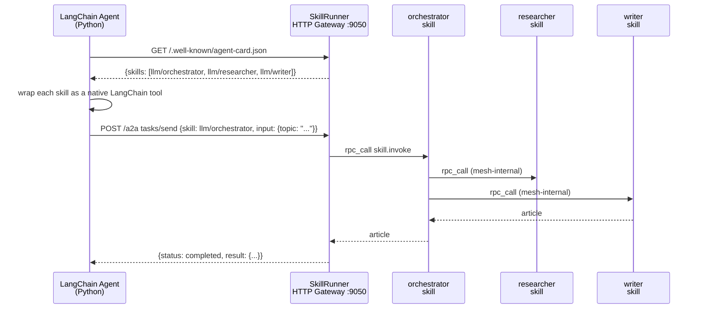

# 08 — A2A Interop: LangChain and AutoGen on the mesh

## Concept

The A2A (Agent-to-Agent) protocol is a simple HTTP standard for agent
discovery: a well-known endpoint (`/.well-known/agent-card.json`) describes what
an agent can do, and a task endpoint (`/a2a`) accepts work. Mycelium
implements both sides of this protocol via `--features a2a`, which means any
framework that speaks A2A — LangChain, AutoGen, or a hand-rolled client — can
discover and call Mycelium skills without knowing anything about gossip,
capabilities, or the mesh topology.

> **What `/a2a` does and does not check.** The route is public by design: a peer needs no Mycelium
> credential. No bearer → the caller is `anonymous`; an *unrecognised* bearer → **401**; a federation
> credential, if presented, is the caller's identity. A malformed request answers JSON-RPC `-32700`.
> What decides whether a skill *runs* is an attached `ActionEvaluator` (chapter
> [20](20-authorising-actions.md)) or a federation edge ([17](17-federation.md)); with neither, an
> anonymous caller reaches skill dispatch and `with_a2a()` warns about exactly that. Building with
> `--features a2a` alone (no `tls`) has no evaluator by construction. The methods the handler knows
> are A2A 1.0's `SendMessage`, `SendStreamingMessage`, `GetTask` and `CancelTask`, 0.3's `message/send`
> and `message/stream`, and the pre-0.2 `tasks/send`, `tasks/sendSubscribe`, `tasks/get` and `tasks/cancel`
> (`tasks/send` and `tasks/sendSubscribe` kept for one release, [`deprecations.md`](deprecations.md) §46) —
> every send through one path, so each runs the same checks. **A task belongs to the
> identity that created it** (since 2.32.0): `tasks/get` and `tasks/cancel` (and `GetTask`, `CancelTask`) answer only the bearer's
> principal that sent it, and a `tasks/send` under an id another identity owns is refused — all
> `-32004`, naming the rule. Task ids are caller-chosen, so they are enumerable; before this any
> client could read another caller's completed artifact or cancel its task by naming the id. An
> anonymous caller has no identity to match: its task is answered only on the `tasks/send` response
> or the `tasks/sendSubscribe` stream that created it (both carry the full result). The id is reserved before the dispatch, so two senders racing
> one new id cannot both run, and only after a federation credential is authorised.



From the Python agent's perspective it made one tool call and got back a
finished article. The mesh-internal routing — orchestrator calling researcher
calling writer — is completely invisible. Mycelium is the routing layer;
the Python agent is just a consumer.

This pattern is useful for:
- Giving existing LangChain/AutoGen workflows access to Mycelium skills
  without rewriting them in Rust
- Letting the mesh absorb the complexity of multi-skill pipelines while
  exposing a simple A2A interface to orchestrators
- Mixing Mycelium skills with non-Mycelium agents in a single workflow

---

## The Example

`examples/a2a_langchain/` provides two agents: a LangChain ReAct agent and an
AutoGen v0.4 agent. Both connect to a running community skills cluster,
auto-discover available skills, and use them to answer a question.

**Prerequisites**

```bash
# Build SkillRunner with A2A support
cargo build --bin skillrunner --features a2a

# Start the community skills cluster
cd examples/community && ./start.sh && cd -

# Install Python dependencies
cd examples/a2a_langchain
pip install -r requirements.txt
```

Set your LLM API key (for the Python agent's own LLM — not the skills):

```bash
export OPENAI_API_KEY=sk-...        # to use gpt-4o-mini
# or set OLLAMA_BASE_URL for local Ollama
```

**Run — LangChain agent**

```bash
cd examples/a2a_langchain
python langchain_agent.py
```

**Expected output** (`langchain_agent.py`; the shape — descriptions and the model's text vary)

```
Connecting to Mycelium at http://localhost:9050 ...

  Connected to: Mycelium cluster
  Discovered 4 skill(s):
    · llm/orchestrator                …
    · llm/researcher                  …
    · llm/writer                      …
    · llm/verifier                    …

Query: …

  [tool call]   llm_orchestrator({'topic': …})
  [tool result] {"title": …, "article": …}...

============================================================
<the model's answer>
```

**Run — AutoGen agent**

```bash
python autogen_agent.py
```

---

## How It Works

**`/.well-known/agent-card.json`** (and, for one release, `/.well-known/agent.json`) is served by the node's
gateway when the node is built with `--features a2a` and enables it (`with_a2a()`). It names `/a2a` once per
protocol version it speaks (`supportedInterfaces`: JSON-RPC `1.0`, then `0.3`), says in its `description` how a
message reaches a skill, and lists the skills `/a2a` can call, scanned from the
capability KV entries at request time. Since 2.27.0 it leaves out what `tasks/send` cannot reach, and
`tasks/send` refuses the same set (`-32001`):

- the fleet's own plumbing — a provisioning tier (`{ns}/loading`, `{ns}/installable`), a stem's shed mark
  (`prov-shed/*`), model metadata (`llm-meta/*`), the artifact librarian, the reason blob cache, and a
  companion's election and role marks (`{ns}/{x}.primary`, `.secondary`, `.candidate`, `.curator`);
- **prompt skills** (`register_prompt_skill` — `mycelium-reason`'s `llm/{model}`, a stem's `[[serve]]`):
  they answer `llm.invoke`, not the `skill.invoke` `/a2a` sends, and are called through
  `POST /gateway/llm/call` under `llm:invoke`. The refusal names that route.

```json
{
  "skills": [
    {
      "id":          "llm/orchestrator",
      "name":        "llm/orchestrator",
      "description": "Coordinates research and writing to produce articles",
      "inputSchema": { "type": "object", "properties": { "topic": {"type": "string"} } }
    }
  ]
}
```

**A standard A2A client** — `a2a-sdk`, and so Strands Agents — reads the card, picks the 1.0 interface and
sends `SendMessage` (or `SendStreamingMessage`). It sends no skill, so a node whose callers are such clients
declares one (since post-360 row N):

```rust
let agent = GossipAgent::new(node_id, cfg)
    .with_a2a()
    .with_a2a_default_skill("depot", "dispatch");   // a message naming no skill goes here
```

A message can still name a skill, in `metadata.skillId` (the message's or the request's); without a default,
one that names none is refused `-32602`. The first part is the skill's input — its text, or its `data`
re-serialised as compact JSON (keys in sorted order; a number beyond an `f64`'s precision is rounded — send exact
values as text). A mandate's possession proof digests `{"text": <that input>}`, so a holder sending a `data` part
signs over the re-serialised form. A mandate and an operation id go in the request's `metadata._meta`. Each message is its own task, complete
when the send returns: a message naming a `taskId` is refused `-32004`. With the SDK:

```python
import asyncio

import httpx
from a2a.client.card_resolver import A2ACardResolver
from a2a.client.client_factory import ClientConfig, ClientFactory
from a2a.helpers.proto_helpers import new_text_message
from a2a.types import Role, SendMessageRequest

async def main():
    async with httpx.AsyncClient(timeout=120) as http:
        card = await A2ACardResolver(http, "http://localhost:9050").get_agent_card()
        client = ClientFactory(ClientConfig(httpx_client=http)).create(card)
        msg = new_text_message('{"topic": "gossip protocols"}', role=Role.ROLE_USER)
        msg.metadata.update({"skillId": "llm/orchestrator"})   # omit to reach the default skill
        async for event in client.send_message(SendMessageRequest(message=msg)):
            print(event)

asyncio.run(main())
```

That path runs in CI against a node (`tests/a2a-sdk/`, the `a2a-sdk` job, `a2a-sdk` 1.2.2).

**`/a2a tasks/send`** (pre-0.2, kept for one release) accepts a task, resolves the skill its `skillId` names,
and dispatches via RPC. The HTTP response waits for the RPC result. `mycelium-py`'s and `mycelium-ts`'
`A2aClient` still send it:

```python
# What A2aClient.send does (mycelium-py) — JSON-RPC 2.0, the input as a text part
import json
from mycelium import A2aClient

client = A2aClient("http://localhost:9050")          # token="…" on a protected gateway
text = client.send("llm/orchestrator", json.dumps({"topic": "gossip protocols"}), timeout_secs=120)
# on the wire: {"jsonrpc":"2.0","id":1,"method":"tasks/send",
#   "params":{"id":"<task>","skillId":"llm/orchestrator",
#             "message":{"role":"user","parts":[{"type":"text","text":"…"}]}}}
```

**LangChain tool wrapping** (`langchain_agent.py`):

```python
from langchain.tools import StructuredTool

def make_tool(skill):
    def call(**kwargs):
        return client.send(skill["id"], json.dumps(kwargs), timeout_secs=120.0)
    return StructuredTool.from_function(
        func=call,
        name=skill["id"].replace("/", "_"),
        description=skill.get("description", ""),
        args_schema=_args_model(skill["id"].replace("/", "_"), skill.get("inputSchema")),  # a pydantic model built from the card's JSON Schema — see the file
    )

tools = [make_tool(s) for s in client.fetch_card().get("skills", [])]
```

---

## Dev Notes

**Build flag required.** A2A routes are compiled in only with `--features a2a`:

```bash
cargo build --bin skillrunner --features a2a
```

Without the flag the gateway starts but `/a2a` and the agent card
return 404.

**Gateway port.** The A2A gateway uses the `http_port` in the skill TOML.
The orchestrator's default is 9050 (`http_port = 9050` in
`orchestrator.skill.toml`). Any skill node can serve A2A — point clients at
whichever gateway has `http_port` set.

**Which skill to expose.** You typically expose the orchestrating skill
(the outermost node) via A2A, not the sub-skills. Clients call the
orchestrator; the mesh handles internal routing transparently.

**Timeout management.** The A2A task endpoint waits for the full RPC chain.
For a 3-skill pipeline on CPU inference this can take 60–90 s. Set
`requests.post(..., timeout=120)` in Python clients accordingly.

**OpenAI vs Ollama for the Python agent.** The Python agent uses its own LLM
for reasoning about which tool to call. Set `OPENAI_API_KEY` for gpt-4o-mini,
or set `OLLAMA_BASE_URL=http://localhost:11434/v1` and `OLLAMA_MODEL=llama3.2`
for local inference. The Mycelium skills use their own separate LLM config.

**Extending to custom clients.** Any HTTP client that can `GET
/.well-known/agent-card.json` and `POST /a2a` a `SendMessage` can use Mycelium skills.
The protocol is intentionally minimal — a JSON description and a task endpoint.
No SDK required.

**AutoGen v0.4 specifics.** `autogen_agent.py` uses the `FunctionTool` API.
AutoGen's tool interface requires `name` to be a valid Python identifier — the
agent strips `/` from skill ids when registering tool names.
